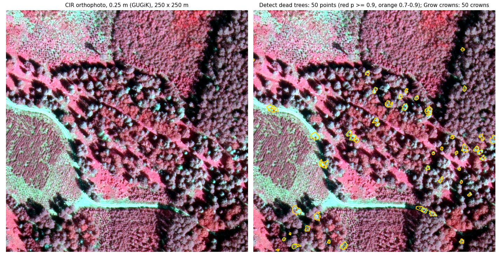
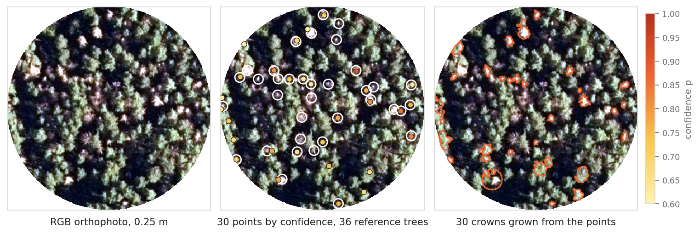

<h1></h1>

[](https://github.com/igorpawelec/geosnag/actions/workflows/python-tests.yml)
[](https://github.com/igorpawelec/geosnag/actions/workflows/qgis-tests.yml)
[](LICENSE)

**Standing dead trees on aerial orthophotos: one point per tree, then the crown grown around it.**

An aerial orthophoto goes in (RGB+NIR, colour infrared or RGB, best at about 0.25 m); a point per standing dead tree comes out, with a confidence, and a crown polygon grown from each point. No tree tops, no canopy height model and no training data are needed. One method, in two forms in this repository:

| | Part | Latest | Install |
|---|---|---|---|
| Python | [`pygeosnag`](python/) |  | `pip install --no-deps "git+https://github.com/igorpawelec/geosnag.git#subdirectory=python"`, after its two dependencies ([details](python/README.md#install)) |
| QGIS | [GeoSnag plugin](qgis/) |  | `geosnag_plugin-<version>.zip` from the [releases page](https://github.com/igorpawelec/geosnag/releases), then *Plugins → Manage and Install Plugins → Install from ZIP* |

The plugin carries the package: its zip is built with `pygeosnag` from `python/` of the same commit ([qgis-tests workflow](.github/workflows/qgis-tests.yml)), so the two cannot drift apart.

**Authors:** Igor Pawelec, University of Agriculture in Kraków. **License:** GPL-3.0-or-later.

## The problem it solves

Standing dead trees (snags) are where a forest's story shows first: bark beetle outbreaks, drought, wind and age all leave standing dead trees before anything else changes. They are habitat, a fuel and a safety concern, and an item foresters count and report. Counting them on the ground is slow; on an aerial orthophoto a bleached or grey crown among green ones is visible to anyone, and national orthophoto programmes fly most of Europe every two to three years at 0.25 m or better.

geosnag turns that imagery into a map of dead trees, one tree at a time:

1. **Adaptels.** The orthophoto is split into superpixels that adapt their size to the local texture, so that a dead crown is covered by a few of them.
2. **Features and a random forest.** Each adaptel is described by its colour, by its contrast to the canopy around it and by its texture, and scored by a forest trained on verified dead trees.
3. **Points.** Adjacent adaptels above the threshold are merged, and each object becomes one point with its confidence.
4. **Crowns.** Each point grows into the pixels around it that still look like the pixel under the point, on NDVI and lightness when there is an infrared band and on CIELAB colour when there is not, while neighbouring points compete for the pixels between them.



*A colour-infrared orthophoto of a pine stand (GUGiK, 0.25 m) and what geosnag makes of it: a point per standing dead tree, coloured by confidence, and the crown grown from each point. Read the colours as a decision: the confidence is written next to every point, so the map can be tightened or loosened afterwards without running anything again.*



*A 0.25 m RGB orthophoto of a circular 100 m sample plot in a spruce stand, with no infrared band (`python/test_data/SNP_21_2020_1.tif`), on which 36 standing dead trees were digitised by hand (the rings), and what geosnag makes of it with its defaults: the RGB forest (`assets-v3/rgb`) at its calibrated cut p ≥ 0.6 places 30 points, and `grow_crowns` grows them into 30 crowns with a median area of 7.1 m². 19 of the 36 reference trees have a point within 1.5 m and 23 within 3 m, so 13 are missed even at the wider radius; 19 of the 30 points have a reference tree within 1.5 m and 23 within 3 m, so 7 sit where no dead tree was digitised. On RGB without infrared the detector finds about half of the trees on this plot. Read the colours as a decision: keeping only the points with p ≥ 0.7 leaves 18 and drops 12, 7 of them more than 1.5 m from any reference tree and 5 within 1.5 m of one, so the stricter map is cleaner and finds 14 of the 36 trees instead of 19. Made by `python/www/figures.py`.*

## Quick start

Python, from the command line or as a library ([details](python/README.md)):

```bash
geosnag detect ortho.tif -o trees.gpkg          # 4 bands: R, G, B, NIR
geosnag grow ortho.tif trees.gpkg -o crowns.gpkg
```

```python
from pygeosnag import detect, grow_crowns

detect("ortho.tif", "trees.gpkg", stands="stands.gpkg")
grow_crowns("ortho.tif", "trees.gpkg", "crowns.gpkg")
```

QGIS, 3.28 or newer ([details](qgis/README.md#quick-start)): *Processing Toolbox → GeoSnag → Detect dead trees*, then *Grow crowns* on the points. A layer of your own points grows just as well.

What the detector finds and misses, measured with the site under test never seen in training, is laid out in [python/README.md](python/README.md#what-to-expect) and, for the plugin's users, in [qgis/README.md](qgis/README.md#what-to-expect).

## What is where

| Path | Content |
|---|---|
| [`python/`](python/) | `pygeosnag`: the package, the `geosnag` command, its tests and changelog |
| [`qgis/`](qgis/) | the GeoSnag plugin for QGIS: the Processing provider, its help pages, tests, and `build_zip.py`, which builds the installable zip |
| [`qgis/docs/`](qgis/docs/index.md) | the plugin's documentation: every option of both tools, the output fields, what to do when the result is not what you expected |
| [`.github/workflows/`](.github/workflows/) | `python-tests`, `qgis-tests` and `qgis-release`, each run only for the folders it covers |

## Releases

Each part is versioned and tagged on its own: `python-vX.Y.Z` and `qgis-vX.Y.Z`. The tags up to `python-v0.5.1` and `qgis-v0.5.1` were carried over, with the full history, from the two repositories the parts used to live in, `pygeosnag` and `qgis-geosnag`. A `qgis-v` tag builds the plugin zip and attaches it to a release.

The models are not in the source tree. They are assets of the releases [`assets-v1` to `assets-v3`](https://github.com/igorpawelec/geosnag/releases) of this repository and are downloaded on first use.

## Citation

The method and its use for standing dead trees are described in:

> Pawelec, I., Hawryło, P., Netzel, P., & Socha, J. (2026). Evaluating superpixel algorithms for standing dead tree delineation using aerial orthoimagery. *International Journal of Applied Earth Observation and Geoinformation*, 147, 105180. https://doi.org/10.1016/j.jag.2026.105180

Each part carries its own citation metadata: [python/CITATION.cff](python/CITATION.cff) and [qgis/CITATION.cff](qgis/CITATION.cff). The works the method builds on are listed in the [Citing section of the plugin's README](qgis/README.md#citing).

## Licence

GNU General Public License v3.0 or later, see [LICENSE](LICENSE). Copyright Igor Pawelec, University of Agriculture in Kraków.
